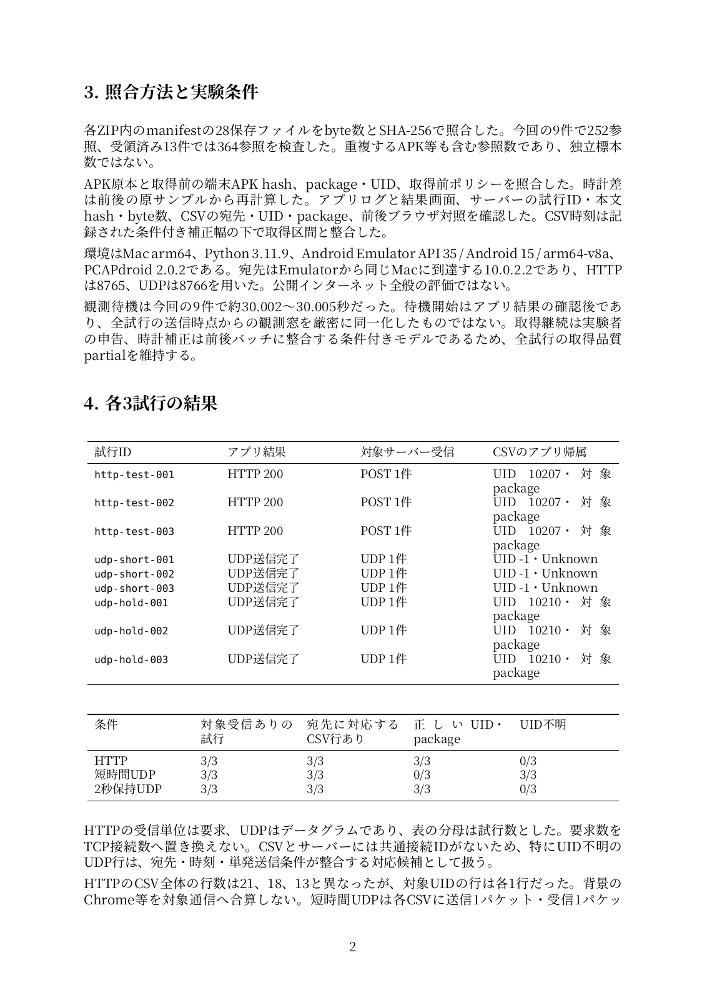
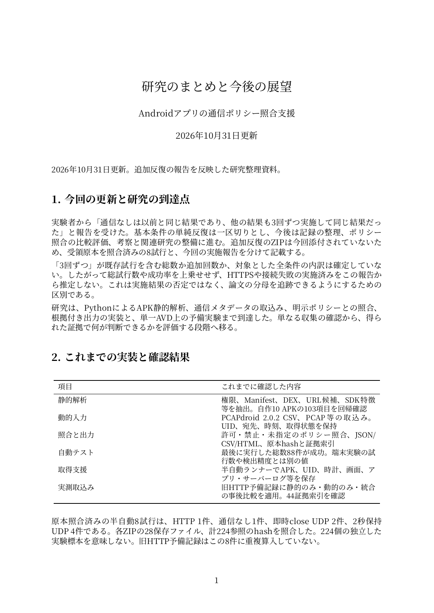

## 2026年10月31日：各条件3試行の原本照合後の結果

- [実験結果と考察（PDF・4ページ）](EXPERIMENT_RESULTS_2026-10-31.pdf)
- [論文草稿・結果反映版（PDF・23ページ）](THESIS_DRAFT_2026-10-31.pdf)
- [TeX・PDF・台帳・照合スクリプト](THESIS_SOURCE_2026-10-31.zip)
- [今回9試行のCSV](EXPERIMENT_RESULTS_2026-10-31.csv)
- [重複を除く全13試行の台帳](EXPERIMENT_LEDGER_2026-10-31.json)

今回の9件を照合し、HTTPは3/3で200応答・帰属を確認、短時間UDPは3/3でサーバー受信あり・UID不明、2秒保持UDPは3/3で受信・帰属を確認しました。4件は完全に同じZIPの再提出であり、二重計数していません。保持時間以外の条件差があるため因果効果とは解釈しません。通信なしの追加原本は未受領の実施報告として区別しています。



以下の以前の資料は、当時の集計・実施報告です。現時点の確認済み件数は上記の新版を参照してください。

## 2026年10月31日：研究のまとめと今後の展望

- [研究のまとめ・今後の展望（PDF・4ページ）](RESEARCH_SUMMARY_OUTLOOK_2026-10-31.pdf)
- [論文草稿改訂版（PDF・23ページ）](THESIS_DRAFT_2026-10-31.pdf)
- [TeX・PDF・表を含む資料一式](THESIS_SOURCE_2026-10-31.zip)
- [まとめのテキスト](RESEARCH_SUMMARY_OUTLOOK_2026-10-31.md)

追加の反復実験は実験者の報告として追記しました。原本照合済みの8試行とは区別し、総試行数は未確定のまま扱います。基本条件の単純反復は一区切りとし、記録整理・ポリシー比較・関連研究の完成へ進む方針です。



# APK監査システム — ダウンロード

## 制御APKの画面修正版 1.1

[HTTP制御APKをダウンロード](http-ui-fixed.apk?raw=true)

旧版でタイトルバーに隠れていた操作ボタンを表示するため、NoActionBarと画面Insetsを明示しました。
ボタンの表記は「通信を実行 / Run test」です。
ビルド・署名・静的103項目を確認しました。修正版の端末画面は利用者側で確認してください。

```bash
adb -s emulator-5554 install -r "$HOME/Downloads/http-ui-fixed.apk"
```

[修正内容と再開手順](UI_FIX.md)

## システム・資料・評価素材一式

[更新済みZIPをダウンロード](apk-audit-research-progress.zip?raw=true)

ZIPを展開するとtraffic_detectフォルダが作成されます。
画面修正版はruns/control-apks-v3-ui、旧素材はruns/control-apks-v2です。
旧素材の検証記録は維持しています。論文PDFの実測は修正前の検証で、今回の画面修正とは別です。

- APK SHA-256: `7c7f24e82c80fb1e51df96923dda326571d3c706d496e03efb6373647df01382`
- ZIP SHA-256: `3d87aa7aa99bf53688a21d17dc461b596a8561e18ae12e82ab33ac1e86ed2481`
- Android上の通信取得・UID帰属の全受入試験や未知アプリの精度評価は未完了です。


## 2026-10-29 HTTP初回観測の追記

- [今回の観測結果](http-pilot-report.md)
- [更新した卒論用PDF](thesis-http-pilot.pdf)
- [TeXとシステムを含むZIP](apk-audit-research-progress.zip)

HTTP対照アプリのUIDに一致するCSV行1件と、参照サーバのPOST受信を確認しました。時計差・取得区間・前後対照が未確認の初回観測として記載し、本評価の精度指標には算入していません。今回添付された原本ログとpackage情報の全文は公開成果物に追加していません。


## 時計差測定と修正計画

- [時計差測定の単独Pythonファイル](measure_android_clock.py)
- [測定手順と制約](CLOCK_MEASUREMENT.md)
- [論文修正計画](REVISION_PLAN.md)

測定ツールは標準ライブラリのみで動作し、端末時計・ネットワーク設定を変更しません。開発側の5件のテストと失敗時のCLI動作を確認済みです。実Emulatorの時計測定はこれから行います。


## Next HTTP trial

[http-004 procedure](HTTP_TRIAL_004.md): before/after clock samples, continuous logcat, browser controls, PCAPdroid export, and screenshots.


## http-004の解析結果（2026-10-29）

- [結果と実際の操作条件](HTTP_004_RESULTS.md)
- [更新した卒論用PDF・18ページ](thesis-http-004.pdf)
- [TeX・システム・記録した解析手順のZIP](apk-audit-research-progress.zip)

対象アプリの200応答、UID一致の通信行、サーバPOST、前後のブラウザ対照と時計測定を確認しました。約14秒後の後対照は実験者の実際の操作条件として記録しました。インストールAPKのハッシュ未取得等の残る条件も明記しています。添付ZIPの原本ログ・画面・package情報の全文は公開成果物へ追加していません。


## APK同定後の取り込みと次の対照

http-004の報告ハッシュはHTTP版1.1と一致しました。21行をrunへ取り込み、3条件×3証拠方式の事後説明用比較、JSON/CSV/HTML、44索引を確認しました。取得・時計の不確実性はpartialのまま保持し、事前ポリシーへの違反や精度評価とは区別しています。総自動テスト76件が成功しました。

- [更新した18ページPDF](thesis-http-004.pdf)
- [更新した結果](HTTP_004_RESULTS.md)
- [システム・TeXのZIP](apk-audit-research-progress.zip)
- [通信なし対照APK](offline-control.apk)
- [offline-001の実験手順](OFFLINE_TRIAL_001.md)
- [取得前に固定したoffline-001ポリシー](OFFLINE_001_POLICY.json)

ビルドinventoryのruntime_statusはビルド時点の履歴です。現在の観測結果はHTTP_004_RESULTS.mdを参照してください。実験者の原本ログ・画面全文と原本リンク付きの研究者用HTMLは公開ZIPへ追加していません。


## PCAPdroidを手動操作する半自動ランナー

- [小型ランナーZIP](guided-trial-runner.zip)
- [導入と実行手順](GUIDED_TRIALS.md)
- [システム・TeX全体](apk-audit-research-progress.zip)
- [更新した論文PDF・19ページ](thesis-guided-runner.pdf)

Python標準ライブラリ、ADB、API 35、PCAPdroid 2.0.2を使います。PCAPdroidの開始・停止・CSV保存と、必要時のブラウザ目視確認は人が担当します。ランナーは固定したHTTP/UDP/通信なしのAPKを対象に、取得前ポリシー・APK/UID/時計・ログ・単発タップ・待機・CSV回収・基本チェック・ZIP作成をまとめます。ホスト側全自動テスト87件（うち11件が模擬ADB/UIを使うランナー試験）が成功。実MacのUI動作は最初の1試行で確認する段階です。


## UDPのUnknown帰属を調べる追加条件

[診断手順](UDP_HOLD_DIAGNOSTIC.md) / [2秒保持条件を含むランナーZIP](guided-trial-runner-udp-hold.zip)。同じpackageのUDP版1.2で、ソケット保持待機とログを追加しました。元のUDP版1.1は履歴として残しています。88件のホスト自動テスト、保持版のビルド・署名・静的解析を確認しましたが、端末でUID帰属が改善するかは未検証です。フィルター後のCSVでUIDが判明するまで原因を確定しません。


## 研究進捗と現時点の論文（2026-10-29）

- [進捗・残作業・今後の流れ（PDF 4ページ）](RESEARCH_PROGRESS_2026-10-29.pdf)
- [進捗のMarkdown](RESEARCH_PROGRESS_2026-10-29.md)
- [現時点の論文草稿（PDF 22ページ）](THESIS_DRAFT_2026-10-29.pdf)
- [文書再ビルド用TeX・図表・PDFのZIP](THESIS_SOURCE_2026-10-29.zip)
- [システムを含む全体ZIP](apk-audit-research-progress.zip)

受領した半自動8試行を照合し、短時間UDP2試行のUID不明と保持UDP4試行の識別を記述しました。版・順序・一部本文長の違い、単一AVDと少数反復、条件付きの時計と取得品質も明記しています。未知アプリ精度、査読関連研究の比較、HTTPS等の本評価、著者情報・大学様式は今後反映する草稿です。文書ZIPを別の場所へ展開し、両PDFが再生成できることを確認しました。受領原本ログ・画面の全文は公開ZIPへ追加していません。
